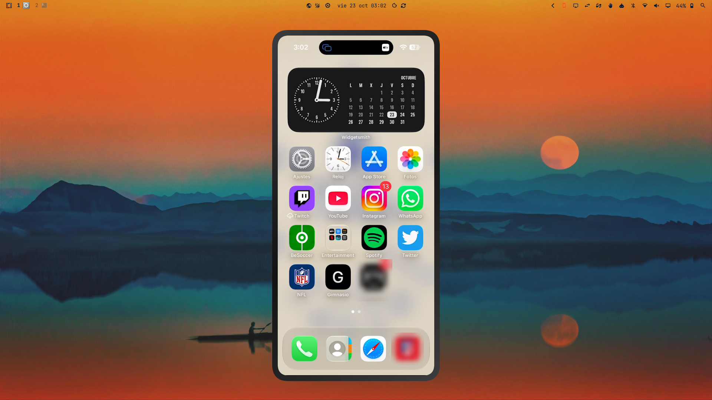

# iPhone for Omarchy

A bar button for [Omarchy](https://omarchy.org) that mirrors your iPhone (or iPad)
screen on your laptop over AirPlay, using [UxPlay](https://github.com/FDH2/UxPlay).

One click starts the AirPlay receiver; another click stops it. The icon lights up
while UxPlay is running.



## Requirements

- Omarchy with a bar that supports plugins.
- [UxPlay](https://github.com/FDH2/UxPlay):

  ```sh
  yay -S uxplay
  ```

- The iPhone and the laptop on the same Wi-Fi network.

## Install

```sh
omarchy plugin add https://github.com/raafaanavrr69/omarchy-iphone-mirror --enable
```

This installs the bar widget `raafaanavrr69.iphone` and places it on the right
side of the bar. Move it with `omarchy bar move raafaanavrr69.iphone --section <section>`.

## Remove

```sh
omarchy plugin remove raafaanavrr69.iphone
```

If UxPlay is still running when you remove the plugin, stop it first by clicking
the icon, or afterwards with:

```sh
systemctl --user stop raafaanavrr69-uxplay
```

## Usage

1. Click the phone icon in the bar.
2. On the iPhone, open Control Center → **Screen Mirroring** and pick the laptop.
3. To stop, click the icon again.

## Firewall

UxPlay is started with `-p`, which pins the AirPlay ports. If you use UFW, open them:

```sh
sudo ufw allow 7000,7001,7100/tcp
sudo ufw allow 6000,6001,7011/udp
```

Discovery uses mDNS (UDP 5353); if the iPhone can't see the laptop, allow it too:

```sh
sudo ufw allow 5353/udp
```

## How it works

`bin/uxplay-ctl` runs UxPlay as a transient systemd user unit
(`raafaanavrr69-uxplay`), so reloading the bar never leaves orphaned processes.
If a `uxplay` started by hand is already running, the button won't launch another one.

You can also use it from the terminal:

```sh
bin/uxplay-ctl status|start|stop|toggle
```

## Credits

The mirroring itself is done by [UxPlay](https://github.com/FDH2/UxPlay)
(GPL-3.0), which you install separately. This plugin does not bundle or modify
it; it only starts and stops the `uxplay` program.

## License

[MIT](LICENSE)

Apple, AirPlay, iPhone and iPad are trademarks of Apple Inc., registered in the
U.S. and other countries. This project is not affiliated with, endorsed by, or
sponsored by Apple Inc.
